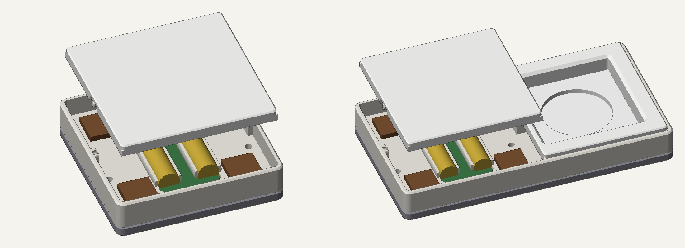
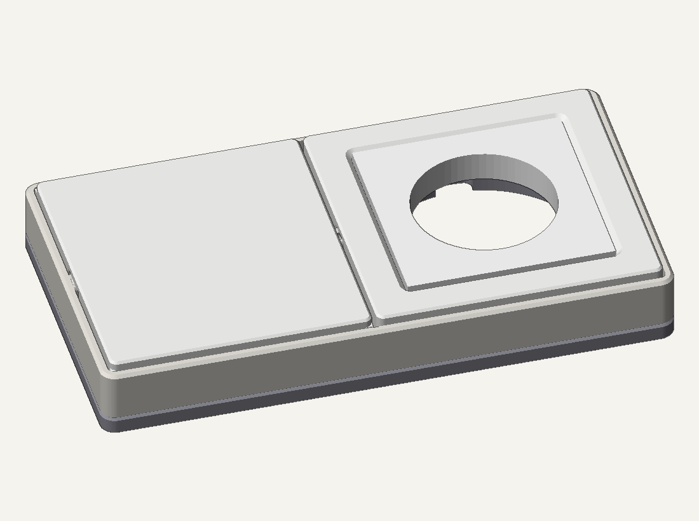
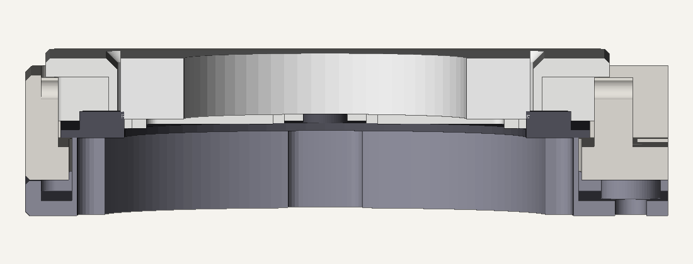

# BILRESA wandschakelaar (3D-print)

Wandschakelaar voor een Europese inbouwdoos waarin de printplaten van de **IKEA BILRESA dual button** (Matter/Thread)
worden ingeklikt. Batterijgevoed (2× AAA per printplaat), geen 230 V nodig.


## Hoe het werkt

- **Basis met geïntegreerd frame** (86 × 103 mm): de BILRESA-printplaat klikt erin, inclusief batterijen.
  Uitdrukgaatjes aan de achterkant en wrikgleufjes om de printplaat er zonder kracht uit te halen.
- **Wip per printplaat**, met geprinte pinnen (2,9 mm) die in klemmetjes klikken (zijwand + brede middensteun).
  Wip recht omhoog trekken = batterijen wisselen.
- **Kailh Choc v1 Brown** (PG1350) aan de boven- en onderkant van elke wip, op 41,5 mm van de as:
  eerst de tactiele bult van de Choc, direct daarna de klik van het BILRESA-knopje.
- **Drukpunten** precies op de knopjes (as midden tussen beide knopjes, 17,75 mm), met verwisselbare **dopjes**
  in 3 diktes (dun / normaal / dik) om af te stellen. Ook de Choc-pennen hebben zulke dopjes.
- **Taps schortje** rondom de wip: bij indrukken kijk je niet naar binnen.
- **Montagebakje**: schroef je op de inbouwdoos (sleuven voor schroeven boven/onder én links/rechts).
  De basis gaat er met 4× **M3 × 8** op. Alles print zonder support.


## Varianten (`print/`)

| Map | Doos | BILRESA's | Choc's | Formaat |
|---|---|---|---|---|
| `V1_enkel_1doos` | enkel | 1 (1 brede wip) | 2 | 86 × 103 |
| `V2_dubbel_1doos` | enkel | 2 | 4 | 86 × 103 |
| `V3_dubbel_2dozen` | dubbel (71 mm) | 2 (1 per doos) | 4 | 157 × 103 |
| `V4_vierdubbel_2dozen` | dubbel (71 mm) | 4 | 8 | 157 × 103 |
| `V5_enkel_2dozen_blind` | dubbel (71 mm) | 1 + blinde helft (180° draaien = links/rechts) | 2 | 157 × 103 |
| `B1_blindplaat_1doos` | enkel | – (blindplaat) | – | 86 × 103 |
| `D2_montagebakje_2_losse_modules` | dubbel (71 mm) | bakje voor 2 losse enkele modules naast elkaar (bv. V2 + B1) | – | 173 × 103 |

### Compacte modellen – 80,5 × 80,5 mm per doos



| Map | Doos | Inhoud | Choc's | Formaat |
|---|---|---|---|---|
| `C1_enkel_compact` | enkel | 1 BILRESA, 1 wip | 4 | 80,5 × 80,5 |
| `C2_enkel_plus_stopcontact_kopp` | dubbel (71 mm) | 1 BILRESA + venster voor een Kopp-stopcontact | 4 | 151,5 × 80,5 |

- Omdat deze modellen lager zijn, zitten de Choc's **naast** de printplaat: 2 boven en 2 onder.
  Zo drukt de wip links en rechts even zwaar en draait hij niet scheef. Met 4 Choc's voelt de wip iets zwaarder
  dan bij V1–V5.
- C2 heeft het stopcontact rechts. Wil je het links hebben, draai dan het hele raam 180°. De BILRESA-knoppen
  boven/onder wisselen dan om; dat pas je aan in HA.
- *(De afbeelding hierboven toont nog de eerste C2-versie; zie hieronder voor de Kopp-versie.)*

#### C2: stopcontact van Kopp



Het stopcontact valt **gelijk met het frame**. Daarvoor ligt het stopcontact ca. 10 mm verder van de muur
dan normaal: in het montagebakje zit een **kraag** (werkt als een verhogingsring voor de inbouwdoos) waar de
draagring op ligt. De kraag steekt door een groot gat in de basis.

Het **dunne klemrandje** (opening 48 mm, inkepingen in het midden van elke kant) zit onderin de
**vensterplaat**. Het stopcontact klemt de vensterplaat vast; die heeft dus geen scharnierpinnen.
Venster 55,8 mm (gemeten 55,5 + speling).

- **Vensterplaat RECHTOP printen** (randje op het bed), dus níét omgedraaid zoals de wip. Geen support nodig.
- **Randdikte:** print eerst de pasproefjes (`deel0`, 1 t/m 4 streepjes = 1,0 / 1,5 / 2,0 / 2,5 mm) en kies dan
  de vensterplaat met dezelfde dikte (`deel3b_vensterplaat_randje_X.Xmm_RECHTOP`).
- **Scheef zittende doos:** alle schroefgaten in het montagebakje zijn sleufjes langs een cirkel. Het raam kan
  daardoor ca. **±3° draaien** en ruim 1 mm opschuiven.



> ⚠️ **230 V.** Zet eerst de groep in de meterkast uit en controleer dat het stopcontact spanningsloos is.
> Twijfel je, laat het stopcontact dan door een installateur plaatsen.

1. Haal het stopcontact en het oude raam los.
2. Schroef het montagebakje aan de BILRESA-kant losjes vast en zet de basis erop (4× M3 × 8).
3. Leg het stopcontact met de draagring **op de kraag** en zet het vast met schroeven die **ca. 10 mm langer**
   zijn dan de oude (bv. 3,5 × 35 of × 40). **Gebruik schroeven, geen spreidklauwen**: de klauwen komen door de
   verhoging niet meer in de doos.
4. Zet alles recht en draai alle schroeven vast. Wip inklikken.
5. Leg de vensterplaat in het vak en zet het stopcontact vast zoals bij het originele Kopp-raam: het dunne
   randje van de vensterplaat komt tussen draagring en stopcontact.

Het geprinte raam raakt geen spanningvoerende delen; het stopcontact zelf blijft dicht. Print het in
**PETG of ASA** (niet PLA). De kraag sluit de ruimte rond het binnenwerk van het stopcontact helemaal af.

Maten aanpassen kan bovenaan `bron/cad12.py` (`KOPP_WIN`, `LIP_IN`, `NOTCHES`) en `bron/cad13.py` (`RAISE`).

Per variant:

- `*_deel1_basis.3mf` – basis met frame
- `*_deel2_montagebakje.3mf` – montagebakje
- `*_deel3_wippen_dopjes_normaal.3mf` – wippen + normale dopjes (of de blindplaat)
- `*_deel4_reserve_dopjes_dun_dik.3mf` – reservedopjes om af te stellen
- `STL/` – dezelfde onderdelen los

## Benodigdheden

- IKEA BILRESA dual button (printplaat uit de behuizing halen)
- Kailh Choc v1 Brown (PG1350); de twee metalen pootjes mogen eraf
- 4× M3 × 8 (cilinder- of bolkop) of parker 2,9 × 9,5 per module
- Doosschroeven van de inbouwdoos
- Printen: PETG of PLA, laagdikte 0,2 mm, geen support

## Montage

1. Montagebakje op de inbouwdoos schroeven.
2. Basis met 4× M3 × 8 op het bakje schroeven (gaatjes in de hoeken, onder de wippen).
3. Printplaten (met batterijen) in de basis klikken, Choc-switches in hun uitsparing drukken.
4. Dopjes op de drukpunten en Choc-pennen schuiven (begin met **normaal**, 2 streepjes).
5. Wippen inklikken: pinnen van bovenaf in de klemmetjes drukken.

### Afstellen

| Wat je merkt | Oplossing |
|---|---|
| BILRESA-knopje klikt niet / wordt niet geraakt | dik knop-dopje (3 streepjes) |
| BILRESA-knopje in rust al ingedrukt | dun knop-dopje (1 streepje) |
| BILRESA klikt vóór je de Choc-bult voelt | dik Choc-dopje |
| Wip voelt in rust al stijf | dun Choc-dopje |

### Printplaat verwijderen

Wip eruit trekken, basis losschroeven, dan **van achteren** gelijkmatig door de uitdrukgaatjes onder beide
batterijen duwen. Nooit aan de printplaat trekken.

## Bron (`bron/`)

Parametrisch ontwerp in Python met [manifold3d](https://github.com/elalish/manifold) en trimesh.

- `cad.py` → `cad7.py` → `cad8.py` → `cad9.py` → `cad10.py`: opeenvolgende versies; `cad10.py` is de actuele.
- `export10.py` schrijft alle varianten naar `out10/`; `check10.py` controleert op botsingen tijdens het kantelen.
- `cad11.py` / `export11.py` / `check11.py`: compact model C1 (naar `out11/`).
- `cad12.py`: Kopp-maten, klemrandje en pasproefjes.
- `cad13.py` / `export13.py` / `check13.py`: C2 met Kopp-stopcontact gelijk met het frame (naar `out13/`).
- De klem voor de printplaat wordt 1-op-1 uit een referentie-basis genomen (`ref/base4c.stl`, niet meegeleverd:
  zie *Credits*). `ref/pocket_outline_unit.pkl` is de daaruit afgeleide contour van de printplaat.

```bash
pip install manifold3d trimesh numpy pillow shapely
cd bron && python export10.py
```

## Credits en licentie

- Gebaseerd op **"IKEA BILRESA Wall Switch Adapter (European 60mm)"** van *theo.fieber* (MakerWorld,
  licentie **CC BY-NC-SA**): oorspronkelijk scharnierprincipe en Choc-idee.
- De klem voor de printplaat en de batterijgoten zijn overgenomen uit de referentie
  *IKEABILRESAWallfourBase* (niet meegeleverd in deze repo).
- Omdat dit een afgeleid werk is, valt dit ontwerp onder **CC BY-NC-SA 4.0** (naamsvermelding, niet-commercieel,
  gelijk delen).
