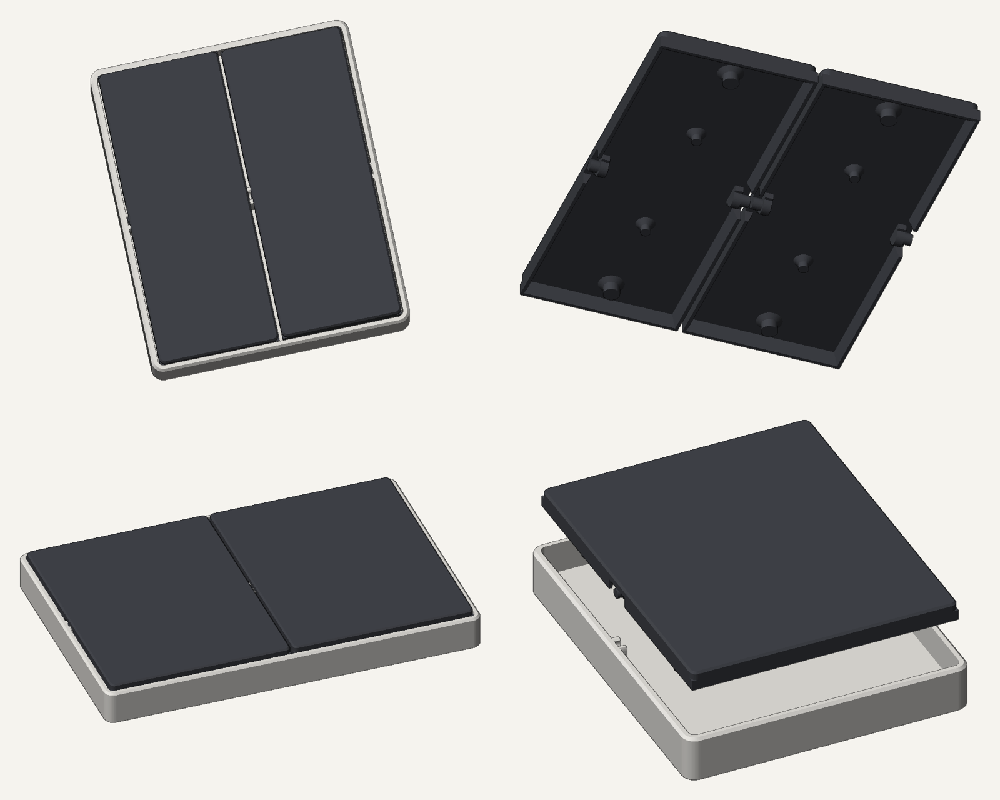
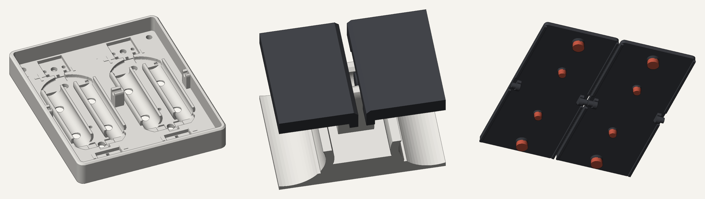

# BILRESA wandschakelaar (3D-print)

Wandschakelaar voor een Europese inbouwdoos waarin de printplaten van de **IKEA BILRESA dual button** (Matter/Thread)
worden ingeklikt. Batterijgevoed (2× AAA per printplaat), geen 230 V nodig.



## Hoe het werkt

- **Basis met geïntegreerd frame** (86 × 103 mm): de BILRESA-printplaat klikt erin, inclusief batterijen.
  Uitdrukgaatjes aan de achterkant en wrikgleufjes om de printplaat er zonder kracht uit te halen.
- **Wip per printplaat**, met geprinte pinnen (2,9 mm) die in klemmetjes klikken (zijwand + brede middensteun).
  Wip recht omhoog trekken = batterijen wisselen.
- **Kailh Choc v1 Brown** (PG1350) aan de boven- en onderkant van elke wip, op 41,5 mm van de as:
  eerst de tactiele bult van de Choc, direct daarna de klik van het BILRESA-knopje.
- **Drukpunten** precies op de knopjes (as midden tussen beide knopjes, 17,75 mm), met verwisselbare **dopjes**
  in 3 diktes (dun / normaal / dik) om af te stellen. Ook de Choc-pennen hebben zulke dopjes.
- **Taps schortje** rondom de wip: bij indrukken kijk je niet naar binnen.
- **Montagebakje**: schroef je op de inbouwdoos (sleuven voor schroeven boven/onder én links/rechts).
  De basis gaat er met 4× **M3 × 8** op. Alles print zonder support.



## Varianten (`print/`)

| Map | Doos | BILRESA's | Choc's | Formaat |
|---|---|---|---|---|
| `V1_enkel_1doos` | enkel | 1 (1 brede wip) | 2 | 86 × 103 |
| `V2_dubbel_1doos` | enkel | 2 | 4 | 86 × 103 |
| `V3_dubbel_2dozen` | dubbel (71 mm) | 2 (1 per doos) | 4 | 157 × 103 |
| `V4_vierdubbel_2dozen` | dubbel (71 mm) | 4 | 8 | 157 × 103 |
| `V5_enkel_2dozen_blind` | dubbel (71 mm) | 1 + blinde helft (180° draaien = links/rechts) | 2 | 157 × 103 |
| `B1_blindplaat_1doos` | enkel | – (blindplaat) | – | 86 × 103 |
| `D2_montagebakje_2_losse_modules` | dubbel (71 mm) | bakje voor 2 losse enkele modules naast elkaar (bv. V2 + B1) | – | 173 × 103 |

Per variant:

- `*_deel1_basis.3mf` – basis met frame
- `*_deel2_montagebakje.3mf` – montagebakje
- `*_deel3_wippen_dopjes_normaal.3mf` – wippen + normale dopjes (of de blindplaat)
- `*_deel4_reserve_dopjes_dun_dik.3mf` – reservedopjes om af te stellen
- `STL/` – dezelfde onderdelen los

## Benodigdheden

- IKEA BILRESA dual button (printplaat uit de behuizing halen)
- Kailh Choc v1 Brown (PG1350); de twee metalen pootjes mogen eraf
- 4× M3 × 8 (cilinder- of bolkop) of parker 2,9 × 9,5 per module
- Doosschroeven van de inbouwdoos
- Printen: PETG of PLA, laagdikte 0,2 mm, geen support

## Montage

1. Montagebakje op de inbouwdoos schroeven.
2. Basis met 4× M3 × 8 op het bakje schroeven (gaatjes in de hoeken, onder de wippen).
3. Printplaten (met batterijen) in de basis klikken, Choc-switches in hun uitsparing drukken.
4. Dopjes op de drukpunten en Choc-pennen schuiven (begin met **normaal**, 2 streepjes).
5. Wippen inklikken: pinnen van bovenaf in de klemmetjes drukken.

### Afstellen

| Wat je merkt | Oplossing |
|---|---|
| BILRESA-knopje klikt niet / wordt niet geraakt | dik knop-dopje (3 streepjes) |
| BILRESA-knopje in rust al ingedrukt | dun knop-dopje (1 streepje) |
| BILRESA klikt vóór je de Choc-bult voelt | dik Choc-dopje |
| Wip voelt in rust al stijf | dun Choc-dopje |

### Printplaat verwijderen

Wip eruit trekken, basis losschroeven, dan **van achteren** gelijkmatig door de uitdrukgaatjes onder beide
batterijen duwen. Nooit aan de printplaat trekken.

## Bron (`bron/`)

Parametrisch ontwerp in Python met [manifold3d](https://github.com/elalish/manifold) en trimesh.

- `cad.py` → `cad7.py` → `cad8.py` → `cad9.py` → `cad10.py`: opeenvolgende versies; `cad10.py` is de actuele.
- `export10.py` schrijft alle varianten naar `out10/`; `check10.py` controleert op botsingen tijdens het kantelen.
- De klem voor de printplaat wordt 1-op-1 uit een referentie-basis genomen (`ref/base4c.stl`, niet meegeleverd:
  zie *Credits*). `ref/pocket_outline_unit.pkl` is de daaruit afgeleide contour van de printplaat.

```bash
pip install manifold3d trimesh numpy pillow shapely
cd bron && python export10.py
```

## Credits en licentie

- Gebaseerd op **"IKEA BILRESA Wall Switch Adapter (European 60mm)"** van *theo.fieber* (MakerWorld,
  licentie **CC BY-NC-SA**): oorspronkelijk scharnierprincipe en Choc-idee.
- De klem voor de printplaat en de batterijgoten zijn overgenomen uit de referentie
  *IKEABILRESAWallfourBase* (niet meegeleverd in deze repo).
- Omdat dit een afgeleid werk is, valt dit ontwerp onder **CC BY-NC-SA 4.0** (naamsvermelding, niet-commercieel,
  gelijk delen).
